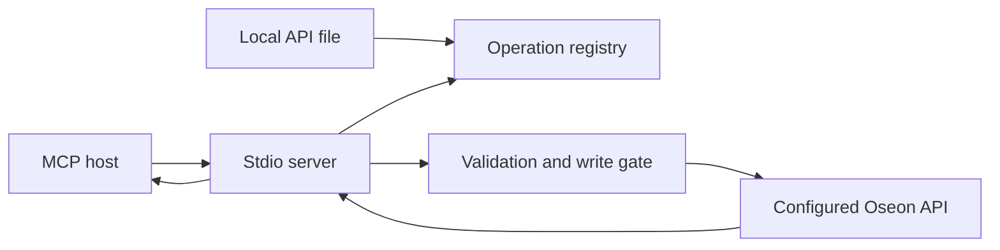

<p align="center"></p>

# Oseon MCP

A local MCP server that discovers and invokes operations from a user-supplied Oseon API file. It uses the MCP Python SDK v2 and starts in read-only mode.

**Use at your own risk. This educational software carries no warranty. Write access can change manufacturing data.**

Related software: [🔌 Official MCP Python SDK](https://github.com/modelcontextprotocol/python-sdk) provides the server and client protocol implementation.



| Guide | Contents |
|---|---|
| [Install and configure](docs/setup.md) | Local API file, authentication and MCP host setup |
| [Use the tools](docs/usage.md) | Discover, describe and invoke operations |
| [Testing and contribution](CONTRIBUTING.md) | Offline tests and private-file coverage |
| [Implementation](ARCHITECTURE.md) | Source ownership and request flow |
| [Changelog](CHANGELOG.md) | Package behavior changes |

First action, from the checkout with Python 3.10+ and uv installed:

```sh
uv sync --locked
```

## About

Built by [Luke van Enkhuizen](https://vanenkhuizen.com) to demonstrate AI + manufacturing integration.

**No TRUMPF affiliation** — Educational project using public API documentation. TRUMPF owns Oseon and its API documentation; this repository does not distribute that documentation.

**MIT License** — [License terms](LICENSE) | **v3.0.0** — Runtime API registry and MCP SDK v2 adapter.
