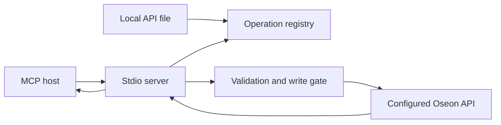

<p align="center"></p>

# Oseon MCP

Inspect Oseon work orders, nestings, stock and remainder sheets with an MCP agent. The server uses MCP Python SDK v2, reads a local API file and starts in read-only mode.

**Use at your own risk. This educational software carries no warranty. Write access can change manufacturing data.**

Related software: [🔌 Official MCP Python SDK](https://github.com/modelcontextprotocol/python-sdk) provides the server and client protocol implementation.



## What you can ask

- **Work orders:** “Which production orders are on the first page?”
- **Nestings:** “Which manufacturing nestings are listed for our workplaces?”
- **Stock:** “What stock does the API show for this article?”
- **Remainder sheets:** “Which remainder sheets currently have positive stock, and where are they?”

The four named tools use declared GET operations. Generic discovery, description and invocation remain available for the rest of the supplied API file. The remainder-sheet tool checks stock for each returned remainder article. If the server limits an unfiltered article list, its result covers only the returned articles. See the [tool usage guide](docs/usage.md).

## Scope

API/MCP parity means support for the declared REST method/path operations in the supplied Swagger 2.0 file, within the documented input and media rules. It does not establish installation-specific availability, permissions or live business outcomes. Mutations require explicit startup opt-in. A read-only SQL connection to TRUMPF systems is **out of scope** for this educational demo.

| Guide | Contents |
|---|---|
| [Install and configure](docs/setup.md) | Local API file, authentication and MCP host setup |
| [Use the tools](docs/usage.md) | Discover, describe and invoke operations |
| [Testing and contribution](CONTRIBUTING.md) | Offline tests and private-file coverage |
| [Implementation](ARCHITECTURE.md) | Source ownership and request flow |
| [Changelog](CHANGELOG.md) | Package behavior changes |

First action, from the checkout with Python 3.10+ and uv installed:

```sh
uv sync --locked
```

## About

Built by [Luke van Enkhuizen](https://vanenkhuizen.com) to demonstrate AI + manufacturing integration.

**No TRUMPF affiliation** — Educational project using public API documentation. TRUMPF owns Oseon and its API documentation; this repository does not distribute that documentation.

**MIT License** — [License terms](LICENSE) | **v2.0.0** — Runtime API registry and MCP SDK v2 adapter.
