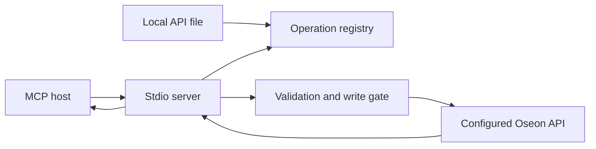

<p align="center"></p>

# Oseon MCP

Ask an MCP agent about Oseon work orders, manufacturing nestings, stock and remainder sheets. The server uses MCP Python SDK v2, loads a locally supplied Swagger 2.0 file and starts in read-only mode.

**Use at your own risk. This educational software carries no warranty. Write access can change manufacturing data.**

Related software: [🔌 Official MCP Python SDK](https://github.com/modelcontextprotocol/python-sdk) provides the server and client protocol implementation.



## Core workflows

- **Work orders:** “Show the first page of production work orders.”
- **Nestings:** “Which manufacturing orders are listed for our workplaces?”
- **Stock:** “What stock does Oseon show for this article?”
- **Remainder sheets:** “Which remainder sheets have positive stock, and where are they?”

Four direct tools handle these questions through declared GET operations. Three generic tools discover, describe and invoke other operations in the local API file. See [tool inputs and result limits](docs/usage.md).

## Scope

The generic tools register every supported REST method/path pair in the supplied Swagger 2.0 file. Registration and offline request tests do not establish that each operation works on a particular installation. The four direct tools were exercised with read-only API requests on one installation; their results depend on that installation's data and permissions. The API may limit unfiltered stock and raw-sheet lists, so a remainder-sheet result does not prove complete inventory coverage. Writes require explicit startup opt-in and have not been tested against a live system. SQL access and creating nestings are outside this connector's current scope.

| Guide | Contents |
|---|---|
| [Install and configure](docs/setup.md) | Local API file, authentication and MCP host setup |
| [Use the tools](docs/usage.md) | Core workflows, generic operations and result limits |
| [Testing and contribution](CONTRIBUTING.md) | Offline tests and private-file coverage |
| [Implementation](ARCHITECTURE.md) | Source ownership and request flow |
| [Changelog](CHANGELOG.md) | Package behavior changes |

First action, from the checkout with Python 3.10+ and uv installed:

```sh
uv sync --locked
```

## About

Built by [Luke van Enkhuizen](https://vanenkhuizen.com) to demonstrate AI + manufacturing integration.

**No TRUMPF affiliation** — Educational project using public API documentation. TRUMPF owns Oseon and its API documentation; this repository does not distribute that documentation.

**MIT License** — [License terms](LICENSE) | **v2.0.1** — Runtime API registry, MCP SDK v2 adapter and read-only workflows.
